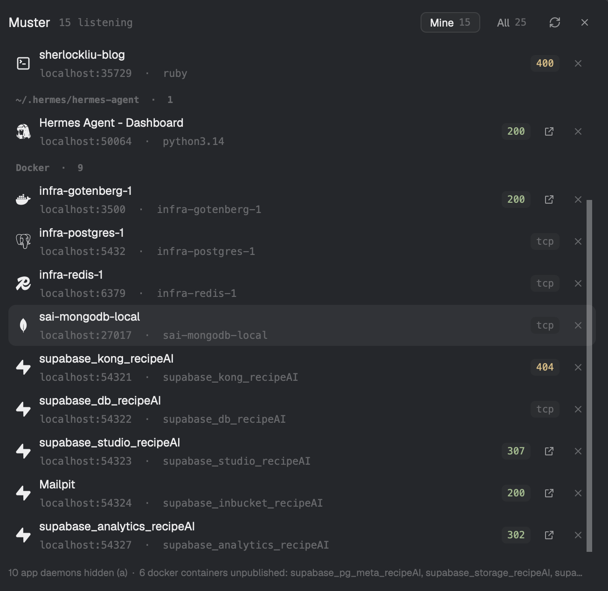

# Muster

A roll-call for your machine: everything listening on a port — the process, the repo it
belongs to, the Docker container behind it, whether it answers — and, unlike a port
list, what your projects said should be running but isn't.



```
Muster   10 listening                        [Mine 10] [All 20]  ⟳  ×

agents  ·  1
  🐍 Hermes Agent - Dashboard                     200  ↗  ×
     localhost:50064 · python3.14
services  ·  3
  ⚡ SME.works — AI Agents for SME Succession…    200  ↗  ×
     localhost:3000 · node · start.js
  ⚡ sai-backend-services-001                      200  ↗  ×
     localhost:8000 · python3.11
Docker  ·  6
  ⚡ supabase_kong_recipeAI                        404  ↗  ×
     localhost:54321 · supabase_kong_recipeAI
  ⚡ supabase_db_recipeAI                          tcp  ×
     localhost:54322 · supabase_db_recipeAI
```

## Install

> Read ~/.config/herdr-app/AGENTS.md, then add this mod: `mods/muster/` from this repo,
> plus the `keys.json` snippet.

Or by hand:

```sh
cp -R mods/muster ~/.config/herdr-app/mods/
herdr-app check ~/.config/herdr-app/mods/muster
```

Then merge `keys.json` (it binds `cmd-shift-o` globally to `mod.open:muster`), or open
it from anywhere with `herdr-app do mod.open '{"name":"muster"}'`.

Removing the folder removes the mod; remove the key line too.

## What you get

| | |
| --- | --- |
| Every listener | port, bind address, process, pid(s), working directory, full command line |
| Grouped | by your Herdr space (longest matching folder), then `Docker`, then the Mac's own daemons |
| Named | the page `<title>` for HTTP servers, the project folder, or the container name — not just `python3.11` |
| Status | HTTP code pill (`200`, `404`, `302`) or `tcp` for Mongo/Postgres/Redis |
| Docker | containers mapped to their published ports by name; containers with **no published port** counted in the footer, so you stop hunting for them |
| Click | open the URL in your browser |
| Right-click | copy `http://localhost:PORT` |
| `×` twice | stop every process holding that port (`TERM`), then rescan |
| `a` | Mine (dev servers + containers) / All (plus macOS daemons) |
| `r` / `Esc` | rescan / close |

## What it runs and reads

- Runs: `lsof` (listeners, working dirs), `ps` (command lines), `docker ps` (container
  names), and `python3` on the bundled `mods/muster/probe.py`.
- Reads: nothing outside its own folder. No config files, no `.env`, no dotfiles.
- Network: `127.0.0.1` only — one `GET /` per unknown port to label it (`200`, page
  title). No telemetry, no remote calls, nothing sent anywhere.
- Writes: nothing outside `~/.config/herdr-app`.

## Requirements

- Herdr desktop app.
- `python3` (present on macOS and most Linux installs).
- `lsof` (macOS, most Linux). Docker is optional — without it the Docker group is just
  absent. Linux `ss` fallback and Windows support are on the roadmap.

## Develop

`probe.py` is standalone; run it in a terminal to see exactly what the panel draws:

```sh
python3 mods/muster/probe.py | python3 -m json.tool
herdr-app check ~/.config/herdr-app/mods/muster     # after each edit
```

Live edits: the app reloads a mod when its files are saved; the panel reopens with the
key (`cmd-shift-o`).

See `docs/PRODUCT.md` for the product design, the gallery comparison (Space Ports, Port
Manager, Servers, run-scripts) and the roadmap — the next milestone is **drift**: what
your repos declare versus what is actually listening.

## License

MIT.
