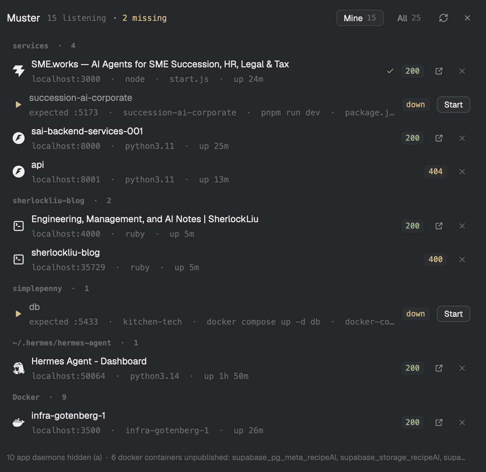

# Muster

A Herdr mod that is a roll-call for this machine: every TCP port something is listening
on, which process and project holds it, which Docker container is behind it, whether it
answers over HTTP — and which of your repos' declared services are *not* running. It
opens as a floating window (`cmd-shift-o`) with a header of counts and filters, a list
grouped by Herdr space → Docker → macOS daemons, and a footer that names the containers
with no published port.

## What you see

A 660×640 floating window on the theme's `popover`, 14px padding, one column:

1. **Header** (one row, 22px controls): `Muster` (14px, semibold), then `10 listening`
   in 11px mono `dim`, a spacer, then two chips — `Mine 10` / `All 20` (11.5px, 22px
   tall, 6px radius; the active chip has `raised` background and `border`, the other is
   text-only in `muted`) — then a refresh icon (13px) and, only when floating, a close
   `×` (12px). Icons are tinted `muted`, on `hover` background when hovered.
2. **List** (`overflow_y_scrollbar`, 1px gap between rows):
   - **Group header**: 10px mono semibold `dim`, uppercase, 8px side padding,
     `NAME  ·  COUNT` — one per space, then `Docker`, then `macOS apps and daemons`.
   - **Row**, 44px tall, 8px side padding, 9px gap, 8px radius, `hover` background:
     a 16px icon (the project's stack: vite/next/django/fastapi/python/node/bun/docker/
     supabase/psql/mongosh, `program.svg` for daemons), then a two-line block —
     **line 1** 12.5px medium `foreground`: the page `<title>` when the port answers
     2xx/3xx, else the project folder name, else the container name, else the space
     name, else the process (`muted` for daemons); **line 2** 11px mono `dim`:
     `localhost:PORT · process-or-container · script.js`;
     then a **status pill** (10.5px mono on `raised`, 18px tall, 5px radius):
     `200` in `ansi2`, `4xx` in `ansi3`, `5xx` in `ansi1`, `tcp` in `dim`;
     then, for HTTP rows, an `↗` open button; then `×` to stop (22×22 controls).
3. **Footer**: 10.5px `dim`, one line — `N app daemons hidden (a)`, the names of up to
   three containers with no published port, and `click a row to open · right-click to copy`.

## How it behaves

- On first show and every 5s it runs `python3 mods/muster/probe.py` and draws the JSON.
  Rows are grouped by the space whose folder is the deepest prefix of the listener's
  working directory (a space rooted at `~` or `/` is ignored: it would claim everything);
  Docker listeners group by `Docker`; anything else by `macOS apps and daemons`.
- Sorted by group then port: dev groups first, `Docker` next, daemons last.
- **Filter** `Mine` (default) hides `kind: app`; `All` shows everything; `a` toggles.
- **Drift rows.** `probe.py` also returns `expected` (declared services). For each one
  the panel finds a listener on the same port: found → that row gets an 11px
  `workspace-chrome/check.svg`, green when the holder's `cwd` is inside the declaring
  repo, amber when it is not. Not found → a synthetic `kind: "missing"` row in the same
  group: `play.svg` in `ansi3`, the service name in `muted`, and a second line
  `expected :PORT · repo · run command · source file`, a `down` pill (or `starting`
  in `working` while it launches), and a 22px `Start` button (`raised`, 1px `input`
  border). The header gains `· N missing` in `ansi3` when any exist.
- **Start** runs `tab.new` with `{name: service, folder: repo, argv: ["/bin/zsh","-lc",
  command], space: that space's id}` — the project's own command, in a new tab of its
  space — then rescans after 3s. A declaration without a `run` command gets no button.
- **Click a row** whose HTTP code is < 400 → `open http://localhost:PORT/`. Rows without
  HTTP are not clickable (no pointer cursor). **Right-click** any row →
  `printf %s <url> | pbcopy` and a 1.5s toast "Copied".
- **`×`** arms the row (`stop?`, red icon); a second click sends `TERM` to every pid on
  that port, toasts `Stopped :PORT`, and rescans after 700ms. Re-rendering (the 5s poll)
  disarms it.
- **`r`** rescans; **`Esc`** closes the window when it floats.
- Empty file: `Nothing of yours is listening…` (Mine) / `Nothing is listening on TCP.`
  (All). A failed probe draws `probe failed: …` in `ansi1` instead of an empty list.

## Built from

- `mods/muster/main.js` — one `View`; `init` starts the poll; `render` builds header,
  list, footer. Uses `herdr`: `exec`, `appHome`, `home`, `spaces`, `theme`, `props`,
  `closeOverlay`, `notify`; `gpui-kit`/`gpui-base` builders only (`v_flex`, `h_flex`,
  `div`, `svg`, `hover`, `on_click`, `on_mouse_down("right", …)`); no `gpui-shell` APIs.
- `mods/muster/probe.py` — the data, standalone. Also reads declarations, per entry in
  `--folder` plus that folder's immediate children that hold a marker
  (`package.json`, `.muster.json`, compose, `Procfile`, `Makefile`, `pyproject.toml`,
  `go.mod`, …), max 40: `.muster.json` first, else `package.json` script + `.env*` port
  + framework default, else `Procfile`, else `Makefile`, plus every compose service's
  published port. Entries: `{name, port, run, folder, source, health}`.
   `lsof -nP -iTCP -sTCP:LISTEN -F pcn`
  for listeners, `ps -o pid=,command=` for command lines, `lsof -a -p … -d cwd -Fn` for
  working directories, `docker ps --format '{{.Names}}\t{{.Status}}\t{{.Ports}}'` for
  names, threads with a 0.45s cap for the HTTP probe (`GET /`, reads 8KB, pulls
  `<title>`). Classifies `kind`: docker (docker proxy or container mapping), dev (working
  directory under `$HOME`, not under `.vscode/.cursor/Library`), app (everything else).
- `mods/muster/mod.json` — `{"place":"none","title":"Muster","focusable":true,
  "overlay":{"kind":"window","width":660,"height":640}}`. `place: none` on purpose: it
  must not dock itself into a layout on first sight.
- `mods/muster/open.svg`, `refresh.svg` — two 24px lucide-style `currentColor` paths.
- `keys.json` — `{"global":{"cmd-shift-o":"mod.open:muster"}}`.
- Program icons come from the app's own `icons/` folder (`vite`, `next`, `python`,
  `docker`, `supabase`, `psql`, `mongosh`, `program`, …); chrome icons from
  `mods/workspace-chrome/` (`x`, `spinner`).

## Watch out

- **`place: none` still docked a copy** in the tests: the layout gained a 320px
  root-level block with `{"mod":"ports"}` when the mod folder appeared *before* its
  `mod.json` existed. Write `mod.json` first, or check the layout afterwards and remove
  any stray block.
- **Saving a file closes the floating copy.** The reload is not in-place for a window
  overlay; reopen with the key.
- `lsof` costs ~0.6–0.8s per run on a busy Mac. With a 5s poll that is a visible blip;
  do not lower the interval, and do not probe HTTP without a hard timeout.
- `lsof`'s field output is the only stable parse: `c` gives a truncated command name
  (`python3.1`), so take the real name from `ps`.
- One port can have several pids (`SO_REUSEPORT`) and a Docker proxy can sit in front of
  a container: collapse by port, keep every pid, prefer the row that has a working
  directory.
- A `<title>` from a 404/500 page ("Error") is not the app's name — only trust titles
  under 400.
- Spaces are matched by folder prefix; a space rooted at `$HOME` matches every listener.
  Skip those, and skip `machine` spaces (a remote folder is not on this disk).
- `docker` may not be on `PATH` inside `exec`: add `/opt/homebrew/bin`,
  `/usr/local/bin`, `~/.local/bin` before calling it, and hide the section when absent.
- The status pill is a single sample, not health: a 200 at `/` says nothing about
  `/healthz`.
- **Herdr spaces are usually a parent folder of several repos**, not one repo. Scanning
  only the space folder finds nothing; scan its children too (`expand()`), and dedupe by
  path or two spaces sharing a folder double every row.
- Reading repo folders goes through the app's own TCC grant: if the app cannot read
  `~/Documents`, `expected` comes back empty and the panel silently looks only like a
  port list. Check with `hc exec -- ls <repo>` before blaming the parser.
- `package.json` and `docker-compose.yml` in one repo are both true: the app is declared
  by one, the infra by the other. Do not make compose an `else` branch.
- A declared port is not a declared *service*: match by port, then verify the holder's
  cwd is inside the repo, or a project on 3000 claims another project's 3000.

## Done when

- `herdr-app check ~/.config/herdr-app/mods/muster` prints `check passed`.
- `herdr-app do mod.open '{"name":"muster"}'`, then `herdr-app status` lists `muster`
  under `overlays` with `"errors": []`; `ls ~/.config/herdr-app/*.error` is empty.
- A screenshot shows the header counts, at least one space group, the `Docker` group,
  a `tcp` row and a `4xx` pill.
- `python3 mods/muster/probe.py` prints valid JSON with `"error": null`, and with every
  server stopped still prints `{"listeners": [], …}`.
- Starting `python3 -m http.server 8123` makes a row appear within 5s with a `200` pill.
- `python3 mods/muster/probe.py --folder fixtures` returns four `expected` entries
  (`api` 8123 from `.muster.json`, `demo-web` 8125 from `package.json` + `.env`, `mail`
  8126 and `pg` 8127 from compose) and scans three folders.
- `herdr-app do tab.new '{"name":"x","folder":"<repo>","argv":["/bin/zsh","-lc","python3 -m http.server 8123"]}'`
  makes a listener appear, proving the Start path's command, and closing that tab frees
  the port.
